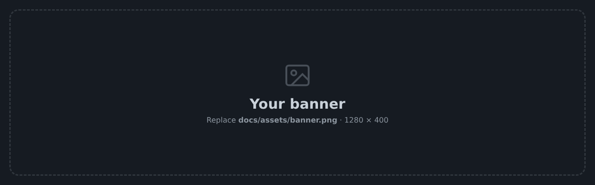
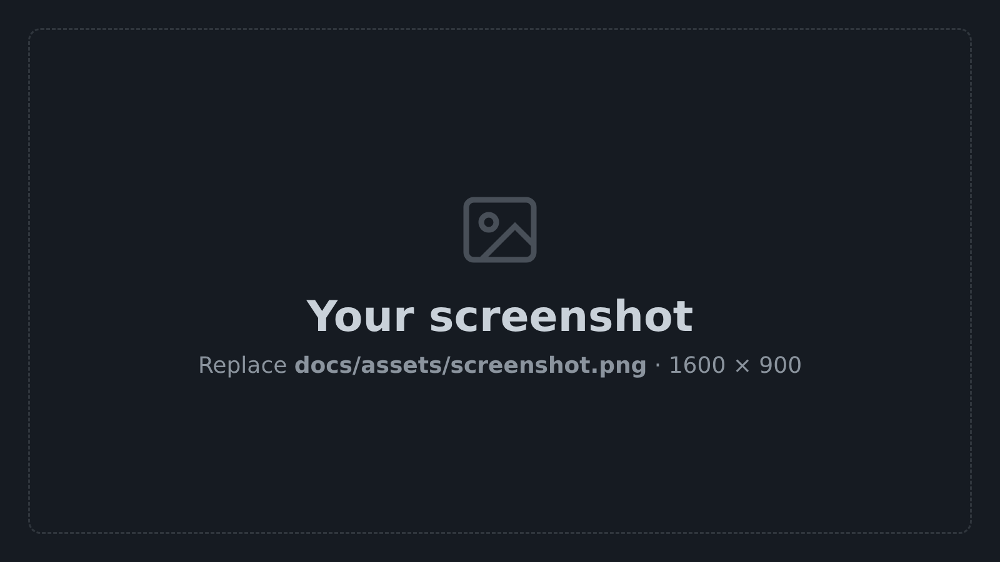

<!-- Replace docs/assets/banner.png with your own image (about 1280×400). Keep the same file name. -->

<h1>YouTube Theme Studio</h1>

<b>Design your own YouTube. Live editor, instant apply, shareable themes.</b>

  
  
  
  

  <a href="https://github.com/t0rqopii/Yt_Skins/releases/latest"><b>Download</b></a>
  &nbsp;•&nbsp;
  <a href="themes/"><b>Themes</b></a>
  &nbsp;•&nbsp;
  <a href="#-install"><b>Install</b></a>
  &nbsp;•&nbsp;
  <a href="https://github.com/t0rqopii/Yt_Skins/issues/new?template=theme_submission.yml"><b>Submit a theme</b></a>
  &nbsp;•&nbsp;
  <a href="https://github.com/t0rqopii/Yt_Skins/issues/new?template=bug_report.yml"><b>Report a bug</b></a>

 

YouTube gives you two themes: light and dark. **Theme Studio gives you an editor.** Change colors, backgrounds, fonts, glass panels, the logo and the layout with a live preview, then apply it to YouTube in one click. You don't need to know any CSS, but there's a box for it if you do.

> [!NOTE]
> No account, no tracking, no network requests. Everything stays in your browser.

 

<!-- Replace docs/assets/screenshot.png with a screenshot of the studio (about 1600×900). Keep the same file name. -->

 

## 🎨 Theme showcase

Import any of these in about ten seconds. See the [full gallery](themes/) for all themes.

<!-- The block below is rebuilt automatically from the themes/ folder. Don't edit it by hand. -->
<!-- THEMES:START -->

<b>4</b> themes and counting

<table>
  <tr>
    <td width="33%" align="center" valign="top">
      
       <b><a href="themes/midnight-tide/">Midnight Tide</a></b>
       dark · glass · aurora
    </td>
    <td width="33%" align="center" valign="top">
      
       <b><a href="themes/neon-arcade/">Neon Arcade</a></b>
       dark · neon · glow
    </td>
    <td width="33%" align="center" valign="top">
      
       <b><a href="themes/paper-light/">Paper</a></b>
       light · minimal
    </td>
  </tr>
  <tr>
    <td width="33%" align="center" valign="top">
      
       <b><a href="themes/sakura-dusk/">Sakura Dusk</a></b>
       dark · pink · gradient
    </td>
  </tr>
</table>
<!-- THEMES:END -->

## ✨ Features

<table>
<tr>
<td width="50%" valign="top">

**🎨 Colors.** Page, panels, text, accent, search bar and category chips.

**🌀 Shader lab.** Animated WebGL backgrounds that react to your mouse.

**🌌 Backgrounds.** Gradients, aurora, or your own image or video, with tint, vignette and patterns.

**🧊 Glass panels.** Frosted header, sidebar, menus and search with adjustable blur.

**🔤 Typography.** Fonts, spacing, case and style for each area. Built-in fonts or upload your own.

**✨ Titles.** Solid, gradient or alternating colors, plus highlights.

**🏷️ Branding.** Swap the logo and name, then animate them along a custom motion path.

**▶️ Player.** Custom progress bar, rounded corners and an ambient glow.

</td>
<td width="50%" valign="top">

**🖼️ Frames and cursor.** Glowing borders on thumbnails and avatars, plus a custom cursor.

**🧹 Declutter.** Hide Shorts, comments, recommendations, view counts, end screens and scrollbars.

**🧩 Element editor.** Click any part of the page and restyle it.

**🐾 Extras.** A companion mascot, hover stickers and a glass search popup.

**💾 Profiles.** Save up to 25 themes and switch between them on YouTube.

**📦 Import and export.** Back up everything to one `.json`, or export plain CSS and JS.

**🛠️ Custom CSS.** Full control when you want it.

</td>
</tr>
</table>

## 📥 Install

Works in **Chrome, Edge, Brave, Opera, Vivaldi** and other Chromium browsers.

1. Download `youtube-theme-studio-x.y.z.zip` from the [**latest release**](https://github.com/t0rqopii/Yt_Skins/releases/latest).
2. **Unzip it** into a folder you'll keep. The browser loads the extension from that folder, so don't delete it.
3. Open `chrome://extensions` (or `edge://extensions`, `brave://extensions`).
4. Turn on **Developer mode** in the top right.
5. Click **Load unpacked** and pick the unzipped folder.
6. Click the extension icon to open the studio, then refresh YouTube.

<b>Updating to a new version</b>

 

Download the new zip and unzip it **over the same folder**. Then click ↻ on the extension card in `chrome://extensions`. Your themes are kept.

## 🧩 Using a theme

1. Open a theme in [`themes/`](themes/) and download its `.json` (click **Download raw file**).
2. In the studio, go to **Export → Import backup** and pick the file.
3. It applies right away and is saved under your profiles.

## 🤝 Share your theme

Made something you like? Add it to the showcase.

- **Easy:** open a [theme submission](https://github.com/t0rqopii/Yt_Skins/issues/new?template=theme_submission.yml) and attach your exported file.
- **Pull request:** add a folder to `themes/` ([guide](CONTRIBUTING.md#share-a-theme)). Once it's merged, it shows up in the showcase automatically.

## 🗺️ Roadmap

- [ ] Chrome Web Store listing
- [ ] Firefox support
- [ ] One-click install from the gallery
- [ ] More built-in themes

Have an idea? [Request a feature](https://github.com/t0rqopii/Yt_Skins/issues/new?template=feature_request.yml).

## 🛠️ Contributing

Bug fixes, features and themes are all welcome. [CONTRIBUTING.md](CONTRIBUTING.md) covers running the extension locally and how the code is organised.

## 📄 License

[GPL-3.0](LICENSE) © [t0rqopii](https://github.com/t0rqopii). Not affiliated with YouTube or Google.

 
If Theme Studio made your YouTube nicer, a ⭐ helps other people find it.

