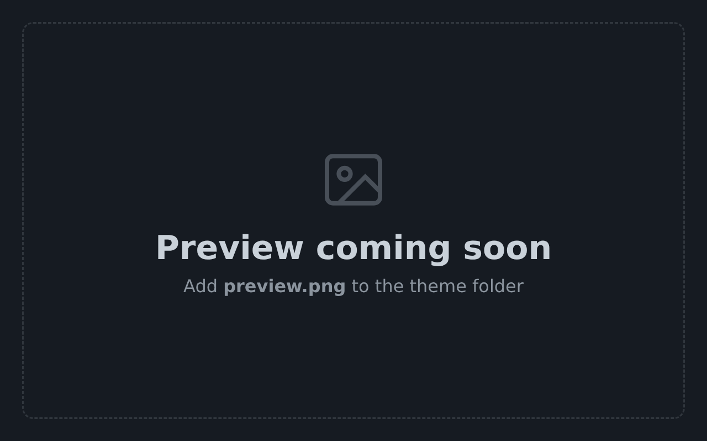

# Theme gallery

Every theme for [YouTube Theme Studio](../), newest first.

**To install one:** open its folder → download the `.json` (**Download raw file**) → in the studio go to **Export → Import backup** and pick the file.

<!-- The table below is rebuilt automatically from the folders here. Don't edit it by hand. -->
<!-- THEMES:START -->
| Preview | Theme | Tags | Author |
|:---:|---|---|---|
|  | [**Midnight Tide**](midnight-tide/) Deep ink background with a slow teal aurora and frosted glass panels. | `dark` `glass` `aurora` | [@t0rqopii](https://github.com/t0rqopii) |
|  | [**Neon Arcade**](neon-arcade/) Synthwave magenta and cyan with glowing search and chips. | `dark` `neon` `glow` | [@t0rqopii](https://github.com/t0rqopii) |
|  | [**Paper**](paper-light/) Warm, quiet light theme with ink text and a terracotta accent. | `light` `minimal` | [@t0rqopii](https://github.com/t0rqopii) |
|  | [**Sakura Dusk**](sakura-dusk/) Plum night sky, blossom-pink accents and soft gradient titles. | `dark` `pink` `gradient` | [@t0rqopii](https://github.com/t0rqopii) |
<!-- THEMES:END -->

## Add yours

Open a [theme submission](../../../issues/new?template=theme_submission.yml), or follow the pull request steps in [CONTRIBUTING.md](../CONTRIBUTING.md#share-a-theme). Your theme is added here automatically once it's merged.
